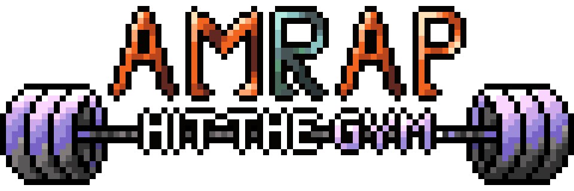

<p align="center">
  
  <br>
  <strong>Roguelite-RPG &bull; Bullet-hell &bull; Action-adventure</strong>
</p>

<p align="center">
  
  <a href="https://github.com/ironloom/loom">
  
  </a>
  
  
</p>

---

# About the game

**AMRAP** is a fast-paced 2D top-down action roguelite blending bullet-hell evasion, punchy combat, and rich character progression. Developed from scratch in [Zig](https://ziglang.org) using the [Loom](https://github.com/ironloom/loom) game engine and [Clay](https://github.com/nicbarker/clay) declarative UI framework, the game challenges players to survive increasingly intense waves of foes while building synergistic smoothie-powered builds.


# Download

Pre-compiled binaries and installers for **macOS** and **Windows** are available on GitHub (Linux builds coming soon):

1. Visit the [Releases](https://github.com/zewenn/amrap/releases) page.
2. Download the latest installer or archive for your platform:
   - `amrap-macos-arm64.dmg` (Apple Silicon M1/M2/M3/M4 - drag-to-Applications installer)
   - `amrap-macos-x86_64.dmg` (Intel macOS - drag-to-Applications installer)
   - `amrap-windows-x86_64-setup.exe` (Windows 10/11 setup wizard)
   - `amrap-windows-x86_64.zip` (Windows 10/11 standalone zip)
3. On macOS, open the `.dmg` and drag `AMRAP` to your `Applications` folder. On Windows, run the setup wizard or extract the standalone `.zip`.

> [!NOTE]
> **macOS First-Time Launch (Gatekeeper):**  
> Because AMRAP is an independent open-source project and not signed with a paid Apple Developer ID, macOS Gatekeeper may warn when opening it for the first time:
> - **Recommended:** Right-click (or Control-click) `AMRAP` in your `Applications` folder, select **Open**, and click **Open** in the prompt.
> - **System Settings:** If blocked, navigate to **System Settings > Privacy & Security**, scroll to the **Security** section, and click **Open Anyway**.
> - **Terminal:** Alternatively, you can remove the quarantine flag directly in Terminal:
>   ```bash
>   xattr -cr /Applications/amrap.app
>   ```


# Build from source

Building AMRAP Reimagined from source is fast and requires only the Zig compiler and Git.

### Prerequisites

- **[Zig](https://ziglang.org/download/)**: Version `0.17.0` or newer.
  > [!TIP]
  > We recommend using [zigup](https://github.com/marler8999/zigup) to effortlessly install and manage Zig compiler versions:
  > ```bash
  > zigup master
  > ```
- **Git**: For cloning the repository and fetching dependencies.

### Clone the Repository

```bash
git clone https://github.com/zewenn/amrap.git
cd amrap
```

### Run in Development

To compile and launch the game immediately in debug mode:

```bash
zig build run
```

### Build Optimized Release

To generate a fully optimized, standalone release binary:

```bash
zig build -Doptimize=ReleaseFast
```

The output binary will be located in:
```bash
./zig-out/bin/amrap
```

### Run Unit Tests

The test suite covers UI components, save persistence, BoonPool logic, and input helpers:

```bash
zig build test
```